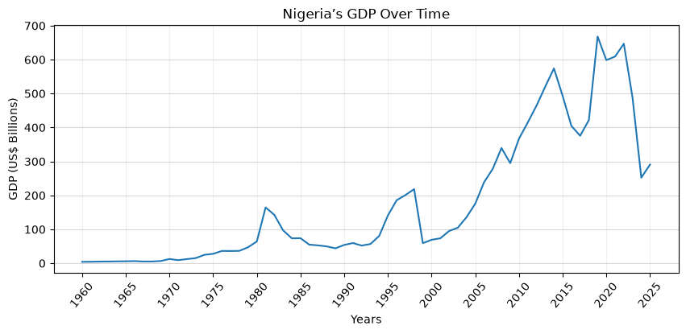
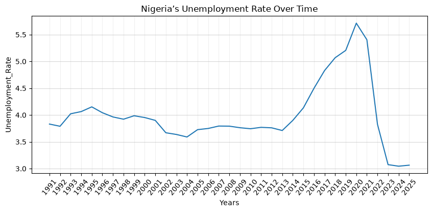
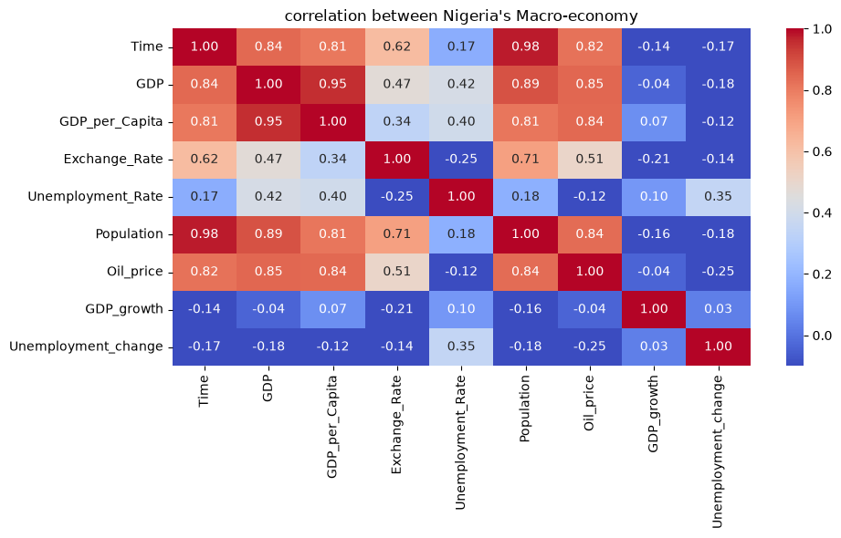
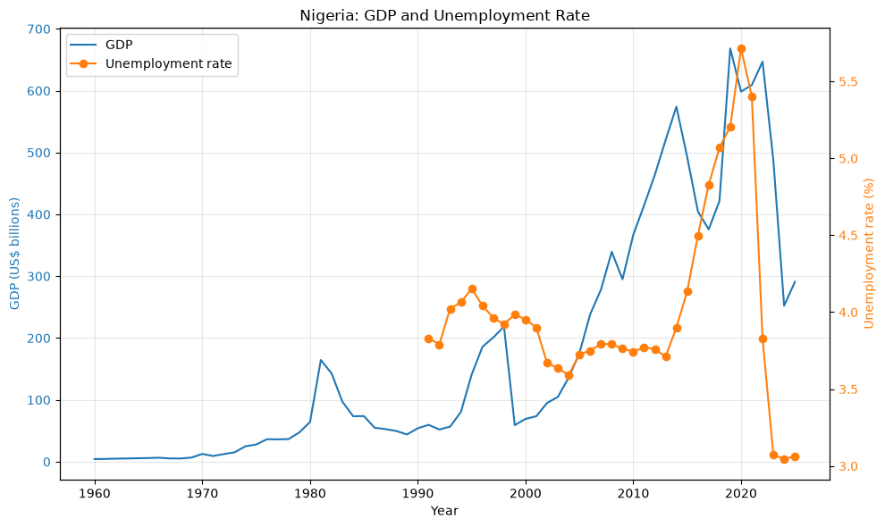
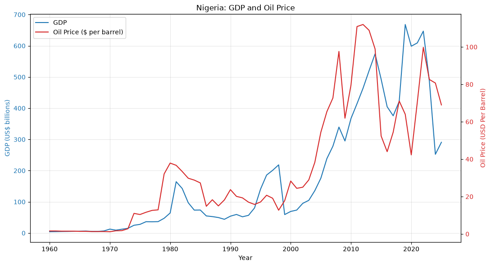
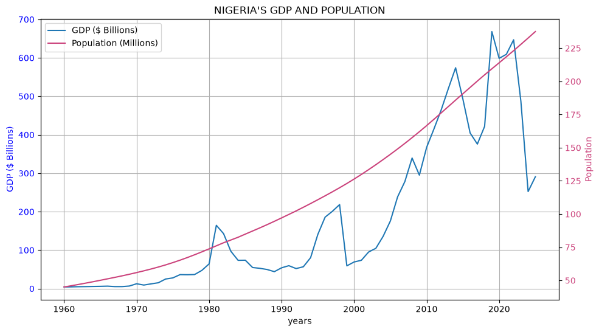
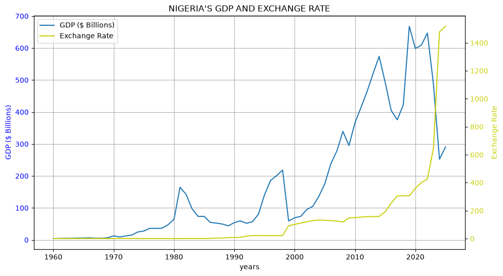
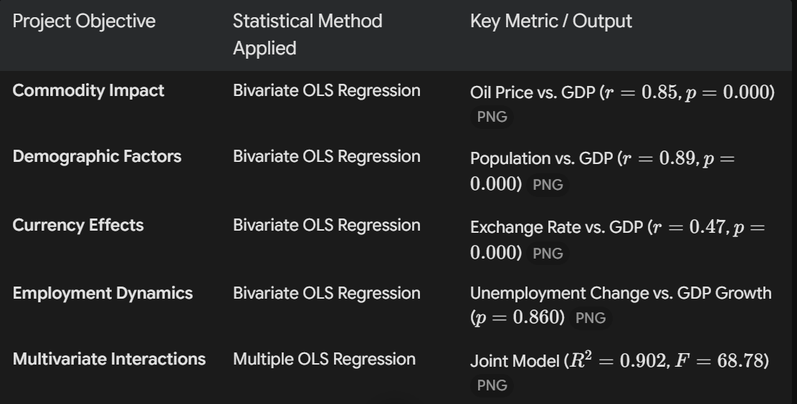

# TOPIC: NIGERIA'S ECONOMIC GROWTH AND MACROECONOMIC INDICATORS

## 1. INTRODUCTION
### RESEARCH MOTIVATION:
This study evaluates whether economic growth in Nigeria serves as an effective engine for job creation. While GDP growth is often cited as a benchmark for national success, its real impact on the population depends on how it interacts with key macroeconomic variables.

### CORE RESEARCH QUESTION:
### Does national economic growth actually translate into improved employment outcomes for Nigerians?

## 2. PROJECT OBJECTIVE:

#### **1. Track Macro Economic Trends: Analyze historical patterns in Nigeria's GDP growth and unemployment rates.**

#### **2. Assess Employment Dynamics: Evaluate whether GDP growth is significantly associated with changes in the unemployment rate.**

#### **3. Measure Commodity Impact: Examine how global oil price movements influence Nigeria's total economic output.**

#### **4. Evaluate Demographic Factors: Investigate the relationship between population growth and aggregate GDP.**

#### **5. Analyze Currency Effects: Explore how fluctuations in foreign exchange rates correspond to GDP changes.**

#### **6. Execute Statistical Modeling: Apply quantitative methods to determine the direction, strength, and significance of relationships among variables.**

#### **7. Deliver Actionable Insights: Present data-driven conclusions to support further econometric research and evidence-based policy making.**

## 3. DATA SOURCES AND VARIABLES

The analysis used historical economic data, primarily from the World Bank's World Development Indicators, alongside international oil-price data from the World Bank's Commodity Price Data (Pink Sheet).

The variables included:
* GDP
* GDP per capita
* Population
* Exchange rate
* Unemployment rate
* International oil prices

## 4. METHODOLOGICAL APPROACH (MAPPING OBJECTIVES TO MODELS)

## 5. OBSERVATIONS
* Macroeconomic Overview: Bivariate analyses demonstrate that population growth ($r = 0.89$) and global oil prices ($r = 0.85$) maintain strong positive associations with Nigeria's GDP, whereas exchange rates display a moderate positive bivariate relationship ($r = 0.47$) that shifts to a negative net predictor in the multivariate model ($\beta = -0.2629$, $p = 0.001$).
* The "Jobless Growth" Finding: In line with the main research question, changes in unemployment showed no statistically significant relationship with GDP growth ($p = 0.860$), indicating that Nigeria's historical GDP expansion has operated largely independently of formal labor market improvements.

## 6. KEY POLICY RECOMMENDATIONS 
* **Diversify the economy:** Invest oil revenues in agriculture, manufacturing, technology, and renewable energy to reduce Nigeria’s exposure to global oil-price shocks.
* **Promote job-creating growth:** Prioritize labour-intensive industries, vocational training, and partnerships between education providers and employers to help translate economic growth into employment.
* **Improve exchange-rate resilience:** Strengthen local production, reduce import dependence, and improve foreign-exchange management, while recognizing that the regression shows an association rather than causation.C
* **Invest in human capital:** Improve healthcare, education, and digital skills so population growth can contribute to productivity and sustainable economic development.
* **Strengthen labour-market data:** Improve timely, reliable employment statistics, including better coverage of informal work, to support evidence-based policymaking.

## 7. OVERALL CONCLUSION
#### Nigeria should focus not only on increasing GDP but also on diversifying production, creating jobs, developing human capital, and strengthening economic resilience.
